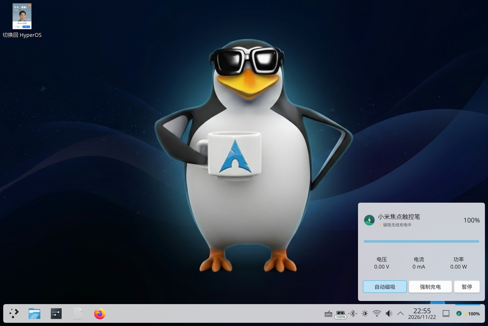
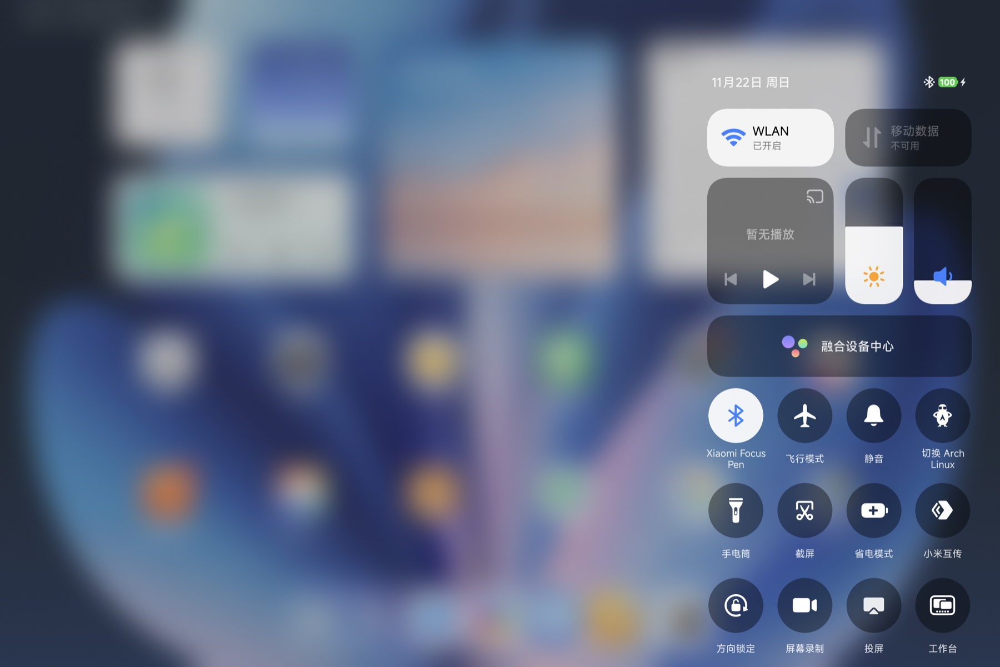

# 小米平板 7 Pro（`muyu` / SM8635）主线 Linux 7.4 + Arch Linux ARM (KDE Plasma 6)

**简体中文** | [English](README_EN.md)

> 为 **小米平板 7 Pro**（代号 `muyu`，高通骁龙 8s Gen 3 / **SM8635** `cliffs`）移植的 **主线 Linux `7.4.0-rc3`** 内核、全套外设驱动与 **无损双系统方案**（原厂 HyperOS 与 Arch Linux ARM + KDE Plasma 6 彼此独立，一键切换）。
>
> 💡 安装其他 Linux 发行版与桌面环境（GUI）原则上同样可行，但本仓库中针对 Arch Linux ARM + KDE Plasma 6 的用户态优化与修复脚本可能不直接适用，需按目标发行版自行适配。
>
> 🔑 **前提条件**：显而易见，刷机装 Linux 需要平板已解锁 Bootloader 并具备完整 Root 权限，没有权限的话就别瞎折腾了。

> [!WARNING]
> **早期可用性说明**：本项目刚刚在真机上跑通不久，长时间连续运行的稳定性尚待验证，不少功能也仍需更多场景实测。当前文档中标注「可用 / 正常」的功能，均代表开机及短时间日常使用验证通过。

---

## 📸 实机截图

|                      Arch Linux ARM + KDE Plasma 6 桌面                       |                       HyperOS 控制中心「切换 Arch Linux」磁贴                        |
| :-------------------------------------------------------------------------: | :------------------------------------------------------------------------: |
|  |  |

---

## ✨ 项目亮点

- **纯净主线 Linux `7.4.0-rc3`**：并非基于 Android 下游内核魔改，而是直接在官方主线 Linux 上整理出 **28 个清晰独立的补丁**（[`kernel/patches/0001`–`0028`](kernel/patches/)），便于后续跟进新版本内核。
- **不破坏原厂系统的无损双系统 + 一键双向切换**：
  - 小米平板 7 Pro 硬件自带 A/B 两套独立的启动分区（原本用于系统无缝 OTA 更新）。本方案把原厂 **HyperOS 完整留在主槽位（Slot A）不动**，把 **Arch Linux ARM + KDE Plasma 6** 装在副槽位（Slot B）以及独立的 `80 GiB` 分区里，两套系统互不干扰，随时有原厂系统兜底。
  - **HyperOS → Linux**：下拉控制中心点击快捷磁贴「切换 Arch Linux」，直接重启冷启动进入桌面 Linux。
  - **Linux → HyperOS**：双击桌面「切换回 HyperOS」图标，一键切回原厂系统。
- **4K60 硬件视频解码与编码（超低功耗观影）**：
  - 为骁龙 8s Gen 3 的 **Qualcomm Iris VPU 3.3** 补齐双管线配置与原厂 QoS 寄存器预设，搭配 [`radxa-pkg/qcom-va-driver`](https://github.com/radxa-pkg/qcom-va-driver) 打通 **Firefox / mpv / FFmpeg / GStreamer** 的零拷贝硬件解码。
  - 真机实测 4K60（H.264 / HEVC 8&10-bit / VP9 / AV1）硬解可达 **135–198 FPS**；Firefox 在线播放 4K 视频时，解码进程 CPU 占用从软解的 `158%` 降至 **`~8%`**。
- **小米焦点触控笔（`P81c`）全功能绘画体验**：
  - **8192 级压感 + 三侧键 + 70° 倾角**：零外部依赖纯 Python 蓝牙直连桥接（[`dualboot/focus_pen_ble.py`](dualboot/focus_pen_ble.py)），自动命名为 `Xiaomi Focus Pen`；倾角直接从屏幕触控帧实时解算。
  - **开箱即用的数位板逻辑**：KDE Plasma 6 绝对定位 + 悬停侧键映射（下键=右键、上键=中键平移、焦点键=`Ctrl+Z` 撤销），已在 **Krita 6** 实测流畅绘画。
  - **磁吸无线充 + 桌面电量小组件**（[`rootfs/pen_charger/`](rootfs/pen_charger/)）：吸在平板侧边自动开启 Qi 无线充电，任务栏实时显示笔电量和充电功率。
- **原装磁吸键盘 & 触控板完整适配**：
  - 打通硬件级 MiAuth 认证（QTEE 5.2.0 + RPMB），彻底解决官方磁吸键盘 8~10 分钟自动断连问题；
  - 支持 **100 级原生背光**（KDE 托盘「亮度与色彩」直接拖动调节）、顶排多媒体快捷键、合盖自动息屏 / 开盖自动亮屏，以及休眠唤醒后自动重连。

---

## 📊 硬件适配状态

| 子系统 | 硬件 / 芯片 | 状态 | 说明 |
| --- | --- | :---: | --- |
| **SoC / 时钟 / 总线** | Qualcomm SM8635 (`cliffs`) | ✅ 正常 | GCC、RPMh、TLMM、IOMMU、UFS |
| **屏幕显示** | 3200×2136 (3:2) @ 120Hz 双 DSI DSC 1.1 | ✅ 正常 | 4nm PHY 同步、双 KTZ8866 背光 |
| **GPU 图形加速** | Adreno 735 (`gen71100`) | ✅ 正常 | Mesa Freedreno + Vulkan（`vulkan-freedreno`），KDE 6 Wayland 流畅渲染 |
| **触摸屏** | Novatek NT36532 (SPI TDDI) | ✅ 正常 | 多点触控，息屏/休眠唤醒正常 |
| **焦点触控笔（`P81c`）** | NT36532 THP + BLE L2CAP ATT | ✅ 正常 | 8192 级压感、70° 倾角、三侧键、悬停直触 |
| **触控笔磁吸无线充** | Qualcomm PMIC GLINK OEM | ✅ 正常 | 吸附自动充、电量 `pen_soc`、功率遥测、KDE 6 面板小组件 |
| **磁吸键盘 & 触控板** | Nanosic WN8030 (I2C) + WN8012 | ✅ 正常 | 全键位、多点触控板、100 级背光、多媒体键、合盖息屏、QTEE MiAuth |
| **Wi-Fi / 蓝牙** | Qualcomm WCN7850 | ✅ 正常 | Wi-Fi 7（`ath12k`）+ 蓝牙 5.4（`hci_qca`） |
| **音频外放** | 四扬声器 AW88261 + AudioReach | ✅ 正常 | `QUINARY_MI2S_RX`，PipeWire + WirePlumber + UCM2 |
| **USB-C / 视频输出** | QMP PHY + WCD9395 USBSS | ✅ 正常 | USB3、USB-NCM 网卡（`172.16.42.1`）、`ttyGS0` 串口、DP0 AltMode |
| **视频硬解 / 编码** | Qualcomm Iris VPU 3.3 (2-pipe) | ✅ 正常 | V4L2 M2M + `qcom-va-driver` VA-API 零拷贝（4K60 H.264/HEVC 8&10-bit/VP9/AV1 ~135–198 FPS，1080p60 硬编 ~345 FPS） |
| **电池 / 供电** | `qcom-battmgr` / PMIC GLINK | ✅ 正常 | 电量计、USB/无线电源状态、已修充电电流符号（KDE 充电图标正常）；通过 `battery_auth` + `input_suspend` 解锁满血 USB-PD `9V/3A`（峰值 `24.8W`，电池净充 `+14.6W`，含温度闭环保护） |
| **内置麦克风 / 传感器** | VA Macro DMIC / SSC 传感器 | ⏳ 待适配 | 录音、重力自动旋转与自动亮度暂未接入 |
| **摄像头 / 指纹 / 马达** | — | ⏳ 未适配 | 暂未点亮 |
| **红外遥控** | — | ⏳ 未适配 | 不是真有人用平板红外遥控吗 😂 |

---

## 🗺️ TODO 列表

- [ ] **内置麦克风录音**：补齐 AudioReach VA Macro DMIC 音频拓扑与 ALSA UCM2 录音通路。
- [ ] **传感器接入（自动旋转 & 自动亮度）**：适配 SSC 加速度计与环境光传感器（`hexagonrpcd` + `iio-sensor-proxy`）。
- [ ] **USB-C Host / 调试网卡一键切换**：提供桌面快捷开关，方便外出直插拓展坞 / U 盘 / 键鼠与回切 USB-NCM 调试。
- [x] **原厂充电器充电功率测试**：已实测小米原厂 67W 充电器在主线 Linux 下握手标准 USB-PD `9V / 1.5A`（USB 输入峰值 `12.4W`，亮屏电池净充 `~5.8W`，电池温升温和 `27.6→29.0°C`；未启用小米私有 PPS 电荷泵快充）。
- [x] **突破 12W PD 限流 / 快充适配**：通过向 PMIC GLINK 写入原厂电池认证（`XM_PROP_AUTHENTIC` / `SLAVE_AUTHENTIC`）并在热插拔时自动触发 `XM_PROP_INPUT_SUSPEND (0x35)` 重跑 AICL，已稳定解锁满血 USB-PD **`9V / 3.0A`（输入峰值 `24.8W`，亮屏电池净充 `+14.6W`，温度 `~31.9°C`）**，并修复了 `BATT_CURR_NOW` 符号反置导致的 KDE 电池充电图标不显示问题；私有 67W PPS 电荷泵（需 UVDM 加密摘要认证）留待后续探索。
- [ ] **深度休眠（`deep`）续航调优**：已实测省电模式息屏 9 小时掉电约 10%，后续继续排查并消除 UFS `hibern8 exit failed` 告警。
- [ ] **平板模式（键盘 360° 反折防误触）**：接入背部霍尔传感器在反折状态下自动禁用键鼠输入。
- [ ] **长时间稳定性验证**：覆盖高负载、频繁休眠唤醒、外接 DP 显示器等场景的持续稳定性测试。
- [ ] **摄像头 / 指纹识别**：视主线支持进展评估适配。

---

## 🛠️ 操作指南与延伸文档

完整的固件提取、内核编译、Arch Linux ARM 根文件系统构建、A/B 双系统无损分区部署与救砖兜底步骤，请直接阅读独立指南：

- 📘 **[完整构建与双系统部署指南 (`docs/INSTALL_GUIDE.md`)](docs/INSTALL_GUIDE.md)** — 从零到一键双向切换的完整实操手册（含分区安全注意事项与 Fastboot 恢复命令）。
- 🔧 **[疑难排障与修复记录 (`docs/TROUBLESHOOTING.md`)](docs/TROUBLESHOOTING.md)** — Iris VPU 3.3 4K60 VA-API 零拷贝、DPMS 息屏触控与磁吸键盘恢复、键盘背光、双 KTZ8866 息屏防闪花等完整排障实录。

> **⚠️ 固件声明**：高通与小米原厂闭源固件不包含在本仓库中，需按指南从你自己的设备原厂分区提取。

---

## 📁 仓库目录结构

```text
.
├── README.md                             # 简体中文说明（本文件）
├── README_EN.md                          # English README
├── docs/
│   ├── INSTALL_GUIDE.md                  # 完整构建与双系统部署指南
│   ├── TROUBLESHOOTING.md                # 硬件解码、待机修复、键盘背光与息屏防闪花排障实录
│   ├── images/                           # 文档展示截图
│   └── device-info/                      # 原厂 6.1 内核配置参考
├── kernel/                               # 主线 Linux 7.4-rc3 内核构建与补丁集
│   ├── patches/                          # 28 个主线 Linux 7.4-rc3 补丁 (0001..0028)
│   ├── Dockerfile                        # 原生 ARM64 GCC 内核编译容器
│   ├── build_kernel.sh                   # 内核构建脚本
│   ├── build_initramfs.sh                # 最小 initramfs 构建脚本
│   ├── pack_bootimg.py                   # Android Boot Image v4 打包脚本
│   ├── muyu_bringup.config               # 最小点亮内核配置片段
│   └── muyu_slim.config                  # 精简生产内核配置（Image < 64 MiB）
├── dualboot/                             # 独立 A/B 双系统与外设桥接工具
│   ├── build_phase3_initramfs.sh         # 独立双系统 switch_root initramfs 脚本
│   ├── build_ubuntu_rootfs.sh            # 可选 Ubuntu 24.04 rootfs 构建脚本
│   ├── focus_pen_ble.py                  # 原生 L2CAP ATT 焦点笔压感/侧键桥接服务
│   ├── setup_dualboot_disk.py            # UFS LUN 0 无损分区切分脚本 (userdata + linux)
│   ├── switch-slot.c                     # 静态编译 ARM64 A/B 槽位切换器 (LUN0/LUN4/UFS BSG)
│   ├── switch-slot.py                    # A/B 槽位切换器 Python 参考实现
│   └── muyu-linux-tile/                  # HyperOS 快捷控制中心磁贴源码
└── rootfs/                               # Arch Linux ARM + KDE Plasma 6 系统定制
    ├── build_arch_kde6.sh                # 一键可复现 Arch Linux ARM + KDE Plasma 6 构建脚本
    ├── muyu-hyperos-icon.png             # 「切换回 HyperOS」自定义桌面图标
    ├── ucm2/                             # 四扬声器 ALSA UCM2 配置
    └── pen_charger/
        ├── muyu-pen-charger.py           # 磁吸无线充守护进程 + 本地 JSON API
        └── org.muyu.pencharger/          # KDE Plasma 6 原生面板小组件 (QML)
```

---

## 🙏 致谢

- **[map220v](https://github.com/map220v)** — `hid-nanosic-wn8030` 磁吸键盘驱动与 `sheng_devauth` QTEE 认证方案。
- **[radxa-pkg/qcom-va-driver](https://github.com/radxa-pkg/qcom-va-driver)** — 高通 Iris VPU 用户态 VA-API 零拷贝驱动与内核 HFI/V4L2 补丁参考。
- **[UniXNU/UniXNU-sheng](https://github.com/UniXNU/UniXNU-sheng)** & **[ianchb/sm8550-mainline](https://github.com/ianchb/sm8550-mainline)** — Nanosic WN8030 背光协议（`0x23`）与 Consumer Control 多媒体键参考。
- **[sonicepro/Linux-xiaomi-sheng](https://github.com/sonicepro/Linux-xiaomi-sheng)** — 小米平板 6S Pro Linux 打包与 `devauth` 集成参考。
- **Junjie Cao** — 上游 `panel-novatek-nt36532.c` 面板驱动框架参考。
- **高通与 Linux 主线社区** — SM8635/SM8650 底层驱动、`qcomtee`、`ath12k`、Freedreno/Mesa 及 AudioReach。
- **Arch Linux ARM & KDE Plasma** — 极客友好的 ARM64 桌面生态。

---

## 📜 开源协议

- 本仓库根目录附带完整 [`LICENSE`](LICENSE)（**GNU General Public License v2.0**）。
- 内核驱动补丁（`kernel/patches/`）遵循 Linux 内核原文件协议（驱动程序为 **GPL-2.0-only**，设备树 `.dts` 为 **BSD-3-Clause**，dt-bindings 头文件为 **GPL-2.0-only OR BSD-2-Clause**）。
- 仓库内的用户态脚本、工具与 KDE 面板小组件除非另有说明，均遵循 **GPL-2.0-or-later** 协议。
