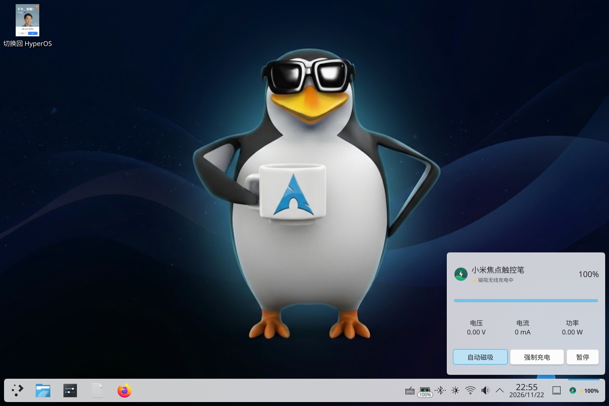
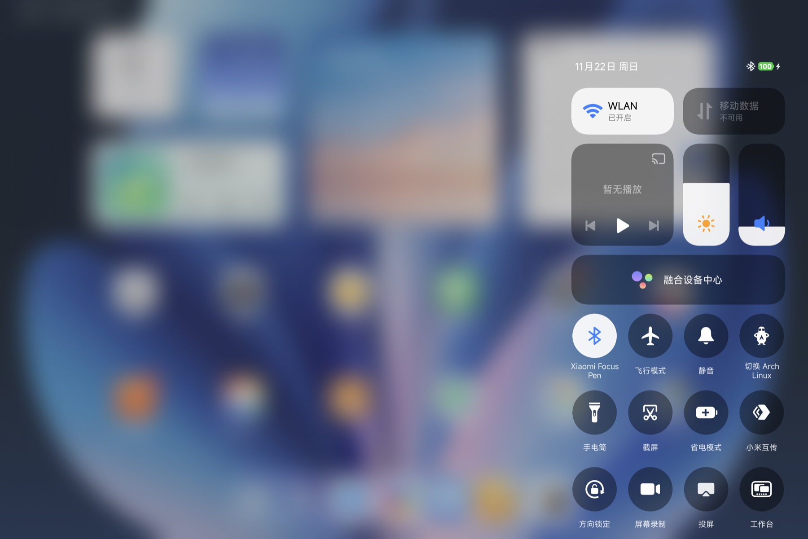

# Xiaomi Pad 7 Pro (`muyu` / SM8635) Mainline Linux 7.4 + Arch Linux ARM (KDE Plasma 6)

[简体中文](README.md) | **English**

> **Mainline Linux (`7.4.0-rc3`)** port, hardware bring-up, and **non-destructive dual-boot** (stock HyperOS alongside Arch Linux ARM + KDE Plasma 6 Wayland, with one-tap switching) for the **Xiaomi Pad 7 Pro** (`muyu`, Qualcomm Snapdragon 8s Gen 3 / **SM8635** `cliffs`).
>
> 💡 Other Linux distributions and desktop environments should also work fine on this kernel, though the Arch Linux ARM + KDE Plasma 6 customizations in `rootfs/` may require adaptation.
>
> 🔑 **Prerequisite**: Installing Linux obviously requires an unlocked Bootloader and full Root access on your tablet.

> [!WARNING]
> **Early-Stage Stability Notice**: This port was only recently brought up on real hardware. Long-term stability is not yet proven, and many features still need broader testing. Features marked as working reflect short-term verification after boot.

---

## 📸 Screenshots

| Arch Linux ARM + KDE Plasma 6 Desktop | HyperOS Quick Settings "Switch to Arch Linux" Tile |
| :---: | :---: |
|  |  |

---

## ✨ Highlights

- **Pure Mainline Linux `7.4.0-rc3`**: Built directly on upstream Linux with **28 self-contained patches** ([`kernel/patches/0001`–`0028`](kernel/patches/)) rather than a downstream Android kernel fork.
- **Non-Destructive A/B Dual-Boot + One-Tap Switching**:
  - Modern Android tablets ship with two independent A/B boot slots (originally designed for seamless OTA updates). This setup leaves **stock HyperOS 100% untouched on Slot A** as a permanent fallback, while running **Arch Linux ARM + KDE Plasma 6** from **Slot B** and a dedicated `80 GiB` partition.
  - **HyperOS → Linux**: Tap the Quick Settings Tile (**切换 Arch Linux**) to cold-boot straight into desktop Linux.
  - **Linux → HyperOS**: Double-click the desktop **Switch to HyperOS** shortcut to return to stock HyperOS.
- **4K60 Hardware Video Decode & Encode**:
  - Full SM8635 (`cliffs`) **Qualcomm Iris VPU 3.3** 2-pipe bring-up with stock QoS register presets, paired with [`radxa-pkg/qcom-va-driver`](https://github.com/radxa-pkg/qcom-va-driver) for zero-copy VA-API acceleration in **Firefox, mpv, FFmpeg, and GStreamer**.
  - Benchmarked at **135–198 FPS** on 4K60 (H.264 / HEVC 8&10-bit / VP9 / AV1) decode, dropping Firefox 4K playback `RDD Process` CPU usage from `158%` to **`~8%`**.
- **Full Xiaomi Focus Pen (`P81c`) Drawing Stack**:
  - **8192-level pressure, 3 side buttons, and 70° tilt**: Zero-dependency Python BLE L2CAP bridge ([`dualboot/focus_pen_ble.py`](dualboot/focus_pen_ble.py)) with automatic `Xiaomi Focus Pen` Bluetooth naming; tilt decoded directly from NT36532 ring-electrode frames.
  - **Wacom-style ergonomics**: KDE Plasma 6 Absolute mode + hover-click side buttons (Lower = Right-Click, Upper = Middle-Click Pan, Focus = `Ctrl+Z` Undo), verified in **Krita 6**.
  - **Magnetic Qi Charging + KDE Panel Widget** ([`rootfs/pen_charger/`](rootfs/pen_charger/)): Auto-charges when snapped to the side with live battery & wattage telemetry.
- **Official Magnetic Keyboard & Touchpad**:
  - Hardware MiAuth handshake via mainline QTEE 5.2.0 + RPMB — eliminates the 8–10 minute disconnect;
  - **100-level native keyboard backlight** (integrated into KDE's Brightness & Color tray slider), top-row Consumer Control media keys, lid auto-sleep/wake, and automatic resume recovery.

---

## 📊 Hardware Support Matrix

| Subsystem | Hardware / Chip | Status | Notes |
| --- | --- | :---: | --- |
| **SoC / Clocks / Bus** | Qualcomm SM8635 (`cliffs`) | ✅ Working | GCC, RPMh, TLMM, IOMMU, UFS |
| **Display** | 3200×2136 (3:2) @ 120Hz Dual-DSI DSC 1.1 | ✅ Working | 4nm PHY sync, dual KTZ8866 backlights |
| **GPU** | Adreno 735 (`gen71100`) | ✅ Working | Mesa Freedreno + Vulkan (`vulkan-freedreno`), smooth KDE 6 Wayland |
| **Touchscreen** | Novatek NT36532 (SPI TDDI) | ✅ Working | Multi-touch, normal blank/resume recovery |
| **Focus Pen (`P81c`)** | NT36532 THP + BLE L2CAP ATT | ✅ Working | 8192-level pressure, 70° tilt, 3 side buttons, hover-click, auto alias |
| **Pen Qi Charging** | Qualcomm PMIC GLINK OEM | ✅ Working | Auto-charge on attach, `pen_soc` & power telemetry, KDE 6 Plasmoid |
| **Magnetic Keyboard** | Nanosic WN8030 (I2C) + WN8012 | ✅ Working | Full keyboard, touchpad, 100-level backlight, media keys, lid sleep, QTEE MiAuth |
| **Wi-Fi / Bluetooth** | Qualcomm WCN7850 | ✅ Working | Wi-Fi 7 (`ath12k`) + Bluetooth 5.4 (`hci_qca`) |
| **Audio Speakers** | Quad AW88261 + AudioReach | ✅ Working | `QUINARY_MI2S_RX`, PipeWire + WirePlumber + UCM2 |
| **USB-C / DisplayPort** | QMP PHY + WCD9395 USBSS | ✅ Working | USB3, USB-NCM (`172.16.42.1`), `ttyGS0` serial, DP0 AltMode |
| **Video Decode/Encode** | Qualcomm Iris VPU 3.3 (2-pipe) | ✅ Working | V4L2 M2M + `qcom-va-driver` zero-copy VA-API (4K60 H.264/HEVC 8&10-bit/VP9/AV1 ~135–198 FPS, 1080p60 encode ~345 FPS) |
| **Battery / Power** | `qcom-battmgr` / PMIC GLINK | ✅ Working | Fuel gauge, USB/wireless telemetry; stock 67W charger negotiates standard USB-PD `9V/1.5A` (`12.4W` peak input, proprietary charge pump not yet enabled) |
| **Internal Mic / Sensors** | VA Macro DMIC / SSC Sensors | ⏳ Pending | Recording, auto-rotation & auto-brightness not yet wired |
| **Cameras / Fingerprint / Haptics** | — | ⏳ Not Yet | Not yet brought up |
| **IR Blaster** | — | ⏳ Not Yet | Does anyone really use a tablet as a TV remote? 😂 |

---

## 🗺️ TODO / Roadmap

- [ ] **Internal Microphone Recording**: Wire up AudioReach VA Macro DMIC topology and ALSA UCM2 capture profile.
- [ ] **Sensors (Auto-Rotation & Auto-Brightness)**: Bring up SSC accelerometer and ALS via `hexagonrpcd` + `iio-sensor-proxy`.
- [ ] **USB-C Host / Gadget Quick Toggle**: Add a one-click desktop toggle between USB Host (docks/drives/peripherals) and USB-NCM debug networking.
- [x] **Stock Charger Fast-Charging Benchmark**: Verified with the stock Xiaomi 67W charger under mainline Linux — negotiates standard USB-PD `9V / 1.5A` (`12.4W` peak USB input, `~5.8W` net battery charge with screen on, `27.6→29.0°C`; proprietary PPS charge pump is not active).
- [ ] **Higher-Wattage PD / Fast Charging**: Investigate raising the ADSP `1.5A` input current limit (`input_current_limit`) or enabling faster PD/PPS charging.
- [ ] **Deep Sleep Overnight Tuning**: Verified ~10% battery drain over 9h screen-off in power-save mode; continue cleaning up the UFS `hibern8 exit failed` resume warning.
- [ ] **Tablet Mode (Folded Keyboard Disable)**: Hook up the rear hall sensor to disable keyboard/touchpad input when folded 360° behind the tablet.
- [ ] **Long-Term Stability Testing**: Extended soak testing under load, repeated suspend/resume cycles, and external DisplayPort monitors.
- [ ] **Cameras / Fingerprint**: Evaluate bring-up as mainline support matures.

---

## 🛠️ Installation Guide & Documentation

For complete step-by-step instructions covering firmware extraction, mainline kernel compilation, Arch Linux ARM rootfs building, non-destructive A/B partitioning, and recovery fallback:

- 📘 **[Complete Build & Dual-Boot Guide (`docs/INSTALL_GUIDE.md`)](docs/INSTALL_GUIDE.md)** — Full step-by-step installation & recovery manual (Chinese).
- 🔧 **[Troubleshooting & Fix Log (`docs/TROUBLESHOOTING.md`)](docs/TROUBLESHOOTING.md)** — Detailed bring-up & bug-fix record (Iris VPU 3.3 4K60 VA-API, DPMS touch/keyboard standby recovery, keyboard backlight, dual-KTZ8866 anti-flash blanking).

> **⚠️ Firmware Notice**: Proprietary Qualcomm & Xiaomi firmware blobs are not redistributed in this repository; extract them from your own device's stock partitions.

---

## 📁 Repository Layout

```text
.
├── README.md                             # Simplified Chinese README
├── README_EN.md                          # English README (this file)
├── docs/
│   ├── INSTALL_GUIDE.md                  # Complete build & dual-boot deployment guide
│   ├── TROUBLESHOOTING.md                # Iris 4K60 VA-API, standby fixes, backlight & anti-flash log
│   ├── images/                           # Documentation screenshots
│   └── device-info/                      # Stock 6.1 kernel config reference
├── kernel/                               # Mainline Linux 7.4-rc3 kernel build & patch series
│   ├── patches/                          # 28 mainline Linux 7.4-rc3 patches (0001..0028)
│   ├── Dockerfile                        # Native ARM64 GCC build container
│   ├── build_kernel.sh                   # Kernel build helper
│   ├── build_initramfs.sh                # Minimal initramfs builder
│   ├── pack_bootimg.py                   # Android Boot Image v4 packer
│   ├── muyu_bringup.config               # Minimal bring-up kernel config fragment
│   └── muyu_slim.config                  # Production slim kernel config (Image < 64 MiB)
├── dualboot/                             # Standalone A/B dual-boot & peripheral bridges
│   ├── build_phase3_initramfs.sh         # Standalone dual-boot switch_root initramfs
│   ├── build_ubuntu_rootfs.sh            # Optional Ubuntu 24.04 rootfs builder
│   ├── focus_pen_ble.py                  # Native L2CAP ATT Focus Pen pressure/button bridge
│   ├── setup_dualboot_disk.py            # UFS LUN 0 GPT splitter (userdata + linux)
│   ├── switch-slot.c                     # Static ARM64 A/B slot switcher (LUN0/LUN4/UFS BSG)
│   ├── switch-slot.py                    # Python reference implementation of A/B slot switcher
│   └── muyu-linux-tile/                  # Native Android Quick Settings Tile
└── rootfs/                               # Arch Linux ARM + KDE Plasma 6 customization
    ├── build_arch_kde6.sh                # Reproducible Arch Linux ARM + KDE Plasma 6 builder
    ├── muyu-hyperos-icon.png             # Custom desktop icon for "Switch to HyperOS"
    ├── ucm2/                             # Quad-speaker ALSA UCM2 profile
    └── pen_charger/
        ├── muyu-pen-charger.py           # Auto Qi magnetic charging daemon + localhost API
        └── org.muyu.pencharger/          # Native KDE Plasma 6 Panel Plasmoid (QML)
```

---

## 🙏 Credits & Acknowledgments

- **[map220v](https://github.com/map220v)** — `hid-nanosic-wn8030` driver and `sheng_devauth` QTEE MiAuth daemon.
- **[radxa-pkg/qcom-va-driver](https://github.com/radxa-pkg/qcom-va-driver)** — Qualcomm Iris VPU userspace zero-copy VA-API driver and kernel HFI/V4L2 patches.
- **[UniXNU/UniXNU-sheng](https://github.com/UniXNU/UniXNU-sheng)** & **[ianchb/sm8550-mainline](https://github.com/ianchb/sm8550-mainline)** — Nanosic WN8030 backlight (`0x23`) and Consumer Control HID report references.
- **[sonicepro/Linux-xiaomi-sheng](https://github.com/sonicepro/Linux-xiaomi-sheng)** — Xiaomi Pad 6S Pro Linux packaging and `devauth` integration reference.
- **Junjie Cao** — Upstream `panel-novatek-nt36532.c` panel driver framework.
- **Qualcomm & Linux Mainline Community** — SM8635/SM8650 drivers, `qcomtee`, `ath12k`, Freedreno/Mesa, and AudioReach.
- **Arch Linux ARM & KDE Plasma** — Rolling ARM64 desktop ecosystem.

---

## 📜 License

- See [`LICENSE`](LICENSE) for the full **GNU General Public License v2.0** text.
- Kernel patches (`kernel/patches/`) follow the original Linux kernel file licenses (**GPL-2.0-only** for drivers, **BSD-3-Clause** for `.dts`, and **GPL-2.0-only OR BSD-2-Clause** for dt-binding headers).
- Userspace scripts, tools, and KDE Plasmoid in this repository are licensed under **GPL-2.0-or-later** unless otherwise noted.
